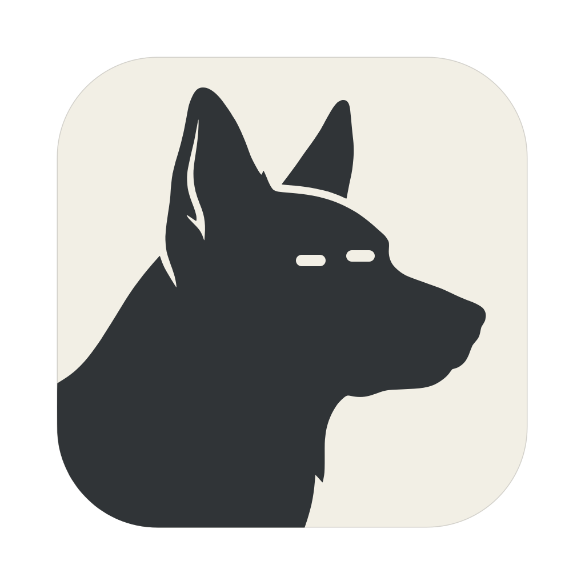
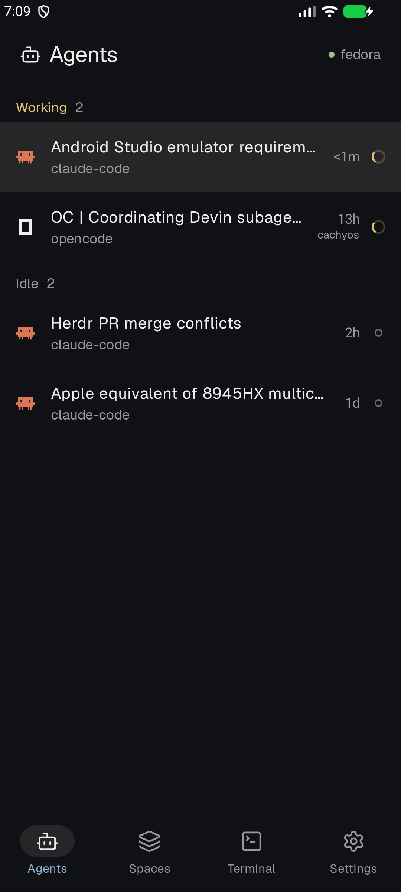
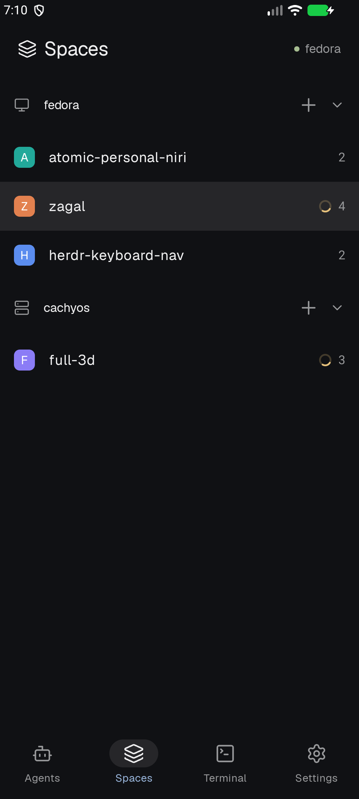
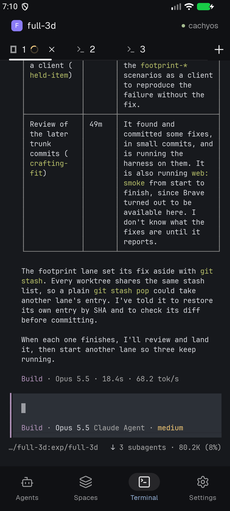
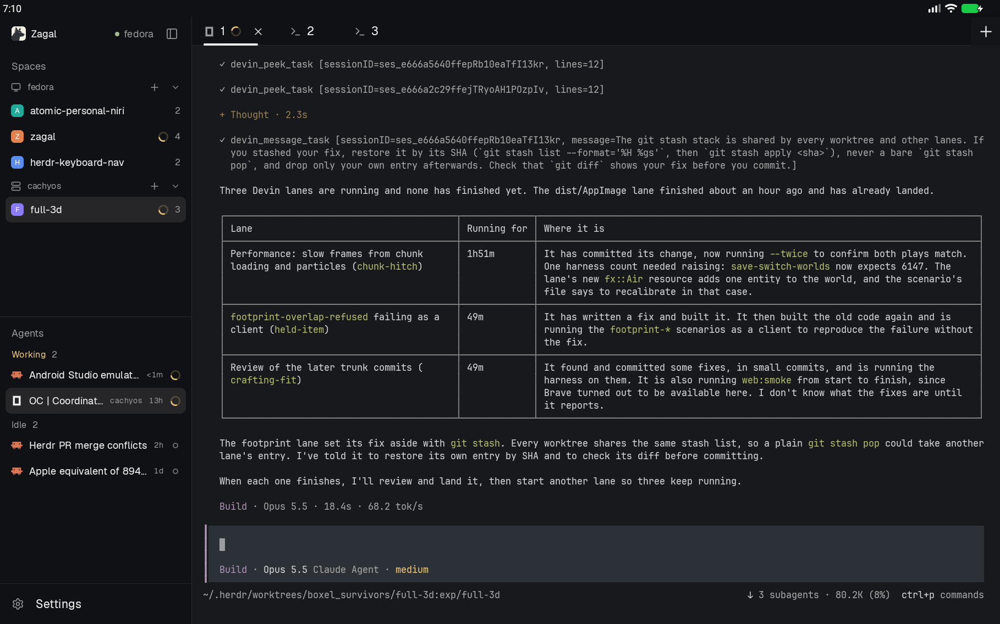

<p align="center">
  
</p>

<h1 align="center">Zagal</h1>

<p align="center">
  An unofficial Android client for <a href="https://github.com/herdrdev/herdr-core">herdr-core</a>, over SSH.
</p>

<p align="center">
  <a href="https://github.com/Osc100/zagal/releases/latest"></a>
  <a href="https://github.com/Osc100/zagal/actions/workflows/ci.yml"></a>
  <a href="LICENSE"></a>
</p>

<p align="center">
  
  
  
</p>
<p align="center">
  
</p>

Zagal connects to your machines over SSH and shows their herdr-core
terminals, laid out like [herdr-app](https://github.com/herdrdev/herdr-app).
It's native, fast, and simple to set up.

Not affiliated with the herdr project.

## What it does

- **Agents**: every agent on every machine, grouped by working, blocked,
  done and idle, with the titles herdr-app gives them.
- **Spaces and tabs**: open, add and close them, as on the desktop.
- **Terminal**: built on [ghostty](https://ghostty.org)'s VT core, with
  colors, mouse modes, scrollback, selection, paste and Nerd Font icons.
  Leaving a terminal doesn't stop its program.
- **Notifications** when an agent finishes or needs you, with a preview of
  its screen.
- **Several hosts at once**, merged into one view. Machines a host reaches
  show up too, with why they're down and a button to reconnect.
- **Tablets** get the desktop's shape: a sidebar beside the terminal.
- **Themes**: herdr's (graphite, ink, moss, paper) or Material You.

There is no account and no server in between: only SSH from your phone to
your machines.

## Requirements

- Android 8.0 or newer.
- On each machine: [herdr-core](https://github.com/herdrdev/herdr-core#install)
  and an SSH server you can reach from the phone, on your local network or
  through a VPN such as Tailscale.

## Install

Get the APK from the [latest release](https://github.com/Osc100/zagal/releases/latest),
or add this repository to [Obtainium](https://obtainium.imranr.dev) for
updates.

## Setup

1. In **Settings**, add a host: `user@host` or `user@host:port`.
2. Zagal shows the host's key fingerprint and the command to check it on the
   host. If they match, trust it.
3. Enter your password once to install the phone's SSH key on the host. It
   isn't saved. If the host doesn't take passwords, Zagal gives you a
   command to run there instead.

On Android 17 and newer, hosts on your local network need the "nearby
devices" permission; Settings shows a banner to allow it.

If the host's herdr-core is older or newer than Zagal supports, Settings says
which one to update.

## Security

- SSH is [JSch](https://github.com/mwiede/jsch) (the maintained fork by
  mwiede), with [Bouncy Castle](https://www.bouncycastle.org/) for the
  algorithms Android's own crypto lacks: Ed25519 keys and signatures, X25519
  and ML-KEM key exchange.
- The phone's SSH key is an ed25519 key generated on the phone by JSch. Its
  private half is encrypted with AES-GCM under a key the
  [Android Keystore](https://developer.android.com/privacy-and-security/keystore)
  holds and never lets out. Showing the private key in Settings takes a
  fingerprint or screen-lock check
  ([BiometricPrompt](https://developer.android.com/identity/sign-in/biometric-auth)).
- Host keys are pinned when you trust them; Zagal won't connect if one
  changes.
- Zagal collects nothing and talks only to the hosts you add.

## Built with

- [JSch](https://github.com/mwiede/jsch) and
  [Bouncy Castle](https://www.bouncycastle.org/) for SSH.
- [ghostty](https://github.com/ghostty-org/ghostty)'s VT core (libghostty-vt,
  through a JNI bridge in [Zig](https://ziglang.org)) for the terminal,
  started from [expo-libghostty](https://github.com/arcboxlabs/expo-libghostty).
- [Jetpack Compose](https://developer.android.com/compose) and
  [Material 3](https://m3.material.io), with Navigation, DataStore and
  Biometric from [AndroidX](https://developer.android.com/jetpack/androidx).
- [kotlinx.coroutines](https://github.com/Kotlin/kotlinx.coroutines) and
  [kotlinx.serialization](https://github.com/Kotlin/kotlinx.serialization)
  for the herdr-core protocol client, a Kotlin Multiplatform module.
- [AndroidSVG](https://github.com/BigBadaboom/androidsvg) to draw
  [Lucide](https://lucide.dev) icons and herdr-app's program icons.

## Building

Needs [mise](https://mise.jdx.dev) and the Android SDK (`ANDROID_HOME`, or
Android Studio's default `~/Android/Sdk`).

```
git submodule update --init --depth 1   # ghostty's source, for libghostty-vt
mise install                            # JDK and Zig
mise run build                          # debug APK, installs beside the release as "Zagal dev"
mise run test
```

Releases are built and signed by CI when a `v*` tag is pushed. How the code
is organized: [docs/ARCHITECTURE.md](docs/ARCHITECTURE.md).

## License

Apache-2.0 ([LICENSE](LICENSE)). Third-party code, fonts and icons keep their
own licenses: see [THIRD-PARTY-NOTICES.md](THIRD-PARTY-NOTICES.md).
